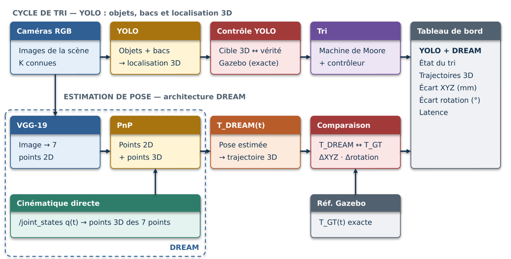
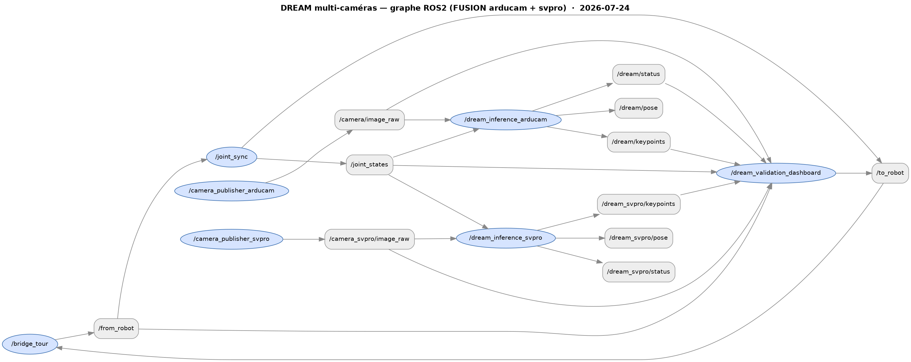

# 📚 Index de Documentation — MyCobot 320 Pi R6A

Bienvenue dans la documentation du projet MyCobot ! Ce fichier sert de carte centrale vers tous les autres documents.

## 🎯 Par où commencer ?

### Première utilisation
- **[README.md](README.md)** — Vue d'ensemble, architecture, quick start, commandes principales
- **[docs/QUICKSTART.md](docs/QUICKSTART.md)** — Démarrage en 3 étapes
- **[CLAUDE.md](CLAUDE.md)** — Onboarding pour les sessions Claude Code + roadmap POC (Isaac Sim, VLA, etc.)

### Système distribué (PC Tour ↔ Pi)
- **[docs/ARCHITECTURE.md](docs/ARCHITECTURE.md)** — Architecture détaillée Tour/Pi + nœuds + topics
- **[docs/DEPLOYMENT.md](docs/DEPLOYMENT.md)** — Guide de déploiement complet

### Suivi du projet
- **[SESSION_RESUME.md](SESSION_RESUME.md)** — Point de départ sessions (état actuel)
- **[DEVELOPMENT_SUMMARY.md](DEVELOPMENT_SUMMARY.md)** — Résumé technique détaillé
- **[CHANGELOG.md](CHANGELOG.md)** — Historique versionné (Keep a Changelog, double track téléop 2.x + sorting 1.x)

---

## 🧭 La démarche du projet — par où lire

Le projet valide la vision (DREAM pour la pose du bras, YOLO pour les objets) **d'abord en
simulation, puis sur le banc réel**, chaque fois **en statique puis en dynamique**, avant de les
réunir sur un cas d'usage : le **tri** de quatre pièces dans quatre bacs. Un document par étape :

| Étape | Gazebo | Banc réel |
|---|---|---|
| 1 · DREAM, images statiques | [training/dream/README.md](training/dream/README.md) · [VGG_ULTIMATE_V4_50K.md](training/dream/VGG_ULTIMATE_V4_50K.md) · [SYNTHETIC_50K_V3.md](training/SYNTHETIC_50K_V3.md) | [PROTOCOLE_REEL.md § étape 8](docs/PROTOCOLE_REEL.md) · [DREAM_DIAGNOSTIC_BIAIS.md](docs/DREAM_DIAGNOSTIC_BIAIS.md) · [REAL3CAM_SESSION6_HOLDOUT.md](training/dream/REAL3CAM_SESSION6_HOLDOUT.md) |
| 2 · DREAM en dynamique | [PROTOCOLE_YOLO_GAZEBO.md § étape 10](docs/PROTOCOLE_YOLO_GAZEBO.md) | [PROTOCOLE_REEL.md § étapes 4-6](docs/PROTOCOLE_REEL.md) · [DREAM_VALIDATION_DASHBOARD.md](docs/DREAM_VALIDATION_DASHBOARD.md) |
| 3 · Tri YOLO, puis YOLO + DREAM | [PROTOCOLE_YOLO_GAZEBO.md](docs/PROTOCOLE_YOLO_GAZEBO.md) · [PICK_AND_PLACE_SIMULATION.md](docs/PICK_AND_PLACE_SIMULATION.md) | [PROTOCOLE_REEL.md § étapes 1 et 9](docs/PROTOCOLE_REEL.md) · [PICK_AND_PLACE_REAL.md](docs/PICK_AND_PLACE_REAL.md) |
| Critères et seuils | [protocole_yolo_gazebo/CRITERES.md](docs/protocole_yolo_gazebo/CRITERES.md) | idem (proposés, pas encore validés pour le réel) |
| Référence du bras (précision) | [GAZEBO_REAL_TABLE.md](docs/GAZEBO_REAL_TABLE.md) | [PROTOCOLE_ESSAIS_PRECISION.md](training/calibration/PROTOCOLE_ESSAIS_PRECISION.md) · [PINCE_SUPPORT_AXE_J6.md](docs/PINCE_SUPPORT_AXE_J6.md) |

**Modèles DREAM en service (octobre 2026)** : `vgg_tri_mix_ft_e10` dans Gazebo,
`vgg_tri_reel_ft_e10` sur le banc réel (test réel hors échantillon : 96,0 %, 1,69 px).
`vgg_montage0901_ft_e30` (1,81 px annoncés le 01/09) est **invalidé** : il mémorisait la
position du socle (test de décalage : 0 %). Voir [CLAUDE.md § DREAM — September 2026 state](CLAUDE.md).

---

## 📋 Documentation par catégorie

### 🚀 Démarrage
| Document | Description |
|----------|-------------|
| [README.md](README.md) | Vue d'ensemble + quick start + index principal |
| [docs/QUICKSTART.md](docs/QUICKSTART.md) | Guide de démarrage rapide |
| [docs/ROBOT_QUICKSTART.md](docs/ROBOT_QUICKSTART.md) | Démarrage côté robot physique |
| [mycobot_gateway/README.md](mycobot_gateway/README.md) | README du package gateway (nœuds, launches, topics) |
| [mycobot_description/README.md](mycobot_description/README.md) | README du package description — contenu, mondes, build |
| [mycobot_description/README_GAZEBO.md](mycobot_description/README_GAZEBO.md) | Détail Gazebo : caméras du URDF, conventions droite/gauche, apparence réaliste |

### 🖐️ Téléopération par la main
| Document | Description |
|----------|-------------|
| [docs/TELEOPERATION.md](docs/TELEOPERATION.md) | Pipeline complet (Astra → Wilor → filtres → JTC), historique commits |
| [docs/TELEOP_ARCHITECTURE_VIZ.md](docs/TELEOP_ARCHITECTURE_VIZ.md) | Visuel détaillé : détection main → mouvement bras (types, unités, latences) |
| [docs/TELEOP_DASHBOARD.md](docs/TELEOP_DASHBOARD.md) | Manuel du dashboard ABMI 3-onglets (Home / Analytics / Tuning) |
| [docs/TELEOP_TUNING.md](docs/TELEOP_TUNING.md) | Référence des paramètres + dépannage téléop |
| [docs/TELEOP_SIM_TESTING.md](docs/TELEOP_SIM_TESTING.md) | **Validation en simulation seule** avant le bras réel : KPIs, scénarios guidés, use cases sim-only (téléop, pick mono, sorting, RoM) |
| [docs/REAL_ROBOT_TEST_PROCEDURE.md](docs/REAL_ROBOT_TEST_PROCEDURE.md) | Protocole de calibration sécurisé sur robot physique (validé 22/04/2026) |

### 🎯 Asservissement visuel en boucle fermée (robot réel)
| Document | Description |
|----------|-------------|
| [docs/PICK_AND_PLACE_BOUCLE_FERMEE.md](docs/PICK_AND_PLACE_BOUCLE_FERMEE.md) | **Document de reprise.** Ce qui a été mesuré sur le robot réel : règles non négociables (`send_coords` écarté, branche coude haut, orientation tournée selon l'azimut), l'affaissement qui fait aussi *pivoter* l'outil, le coût en allonge de l'outil vertical, l'ordre correct de la descente, les pièges de calcul (auto-test IK, extrinsèque qui dérive en bloc, déport validé sur son propre point) et le biais latéral encore ouvert ; § 6 quater (24/08) : l'invariant « objet en main, jamais de retour au ramassage », la détection du carton par creux sombre, la portée réelle de 350 mm, l'appui SVPRO, et les 22,7 s d'attente par mouvement supprimées |
| [mycobot_gateway/launch/visual_servo.launch.py](mycobot_gateway/launch/visual_servo.launch.py) | Lancement de la boucle — démarre **désarmé** (`dry_run:=true`), attend un `start` explicite. Prérequis et pièges dans le docstring |
| [mycobot_gateway/mycobot_gateway/visual_servo/state_machine.py](mycobot_gateway/mycobot_gateway/visual_servo/state_machine.py) | Machine à états SEARCH→TRACK→APPROACH→FINE_SERVO→DESCEND→GRASP→LIFT→PLACE, testable sans matériel |
| [mycobot_gateway/mycobot_gateway/visual_servo/safety.py](mycobot_gateway/mycobot_gateway/visual_servo/safety.py) | Superviseur : 9 conditions d'arrêt, dont l'incohérence commande/mouvement mesuré |
| [training/calibration/calibrate_camera_base_extrinsic.py](training/calibration/calibrate_camera_base_extrinsic.py) | Extrinsèque caméra→base : 16 coins, RANSAC+LM, **validation leave-one-out** |
| [scripts/diff_ik.py](scripts/diff_ik.py) | IK différentielle sur **matrice de rotation**. Son docstring explique pourquoi `send_coords` est écarté |

> ⚠ **`send_coords` est inutilisable sur cette unité.** Mesuré le 20/08 sur cible
> identique : 247,8 mm d'erreur contre 18,2 mm via `send_angles` + IK, les deux
> avec un `OK` du bridge — la méthode constructeur échoue en silence (blocage de
> cardan à RY ≈ −80°). Voir le CHANGELOG § Corrigé.

### 🎯 Pick-and-place / sorting (Gazebo)
| Document | Description |
|----------|-------------|
| [docs/SIMULATION_GAZEBO_EXPLICATION.docx](docs/SIMULATION_GAZEBO_EXPLICATION.docx) | **Word, pour lecteur non-ROS.** À quoi sert la simulation, ce qui est simulé, comment les trois briques (Gazebo / ros2_control / nœud de tri) s'articulent, le cycle en 10 étapes, les quatre défauts que le banc a permis de trouver, et ce que la simulation ne dit **pas** du robot réel |
| [docs/PICK_AND_PLACE_SIMULATION.md](docs/PICK_AND_PLACE_SIMULATION.md) | **Tri des quatre objets par saisie PHYSIQUE** (plus de téléportation). ⚠ **L'issue n'est pas déterministe** (mesuré 22/09 sur 7 cycles : le cylindre sort du bac 4 fois sur 7 à géométrie commandée identique) — le 4/4 du 31/08 est un tirage, pas un état ; lancement, graphe ROS, géométrie de la pince en chiffres (point outil au centre des patins, ouverture et encombrement selon l'angle, les 6 valeurs du contrôleur), cycle en 10 étapes, et les trois contraintes non évidentes — bac vert par-dessus l'épaule, pointe plafonnée à ~140 mm, doigts qui entrent dans le bac mais ne peuvent pas s'y ouvrir |
| [mycobot_description/README_GAZEBO.md](mycobot_description/README_GAZEBO.md) | Worlds disponibles : `pick_and_place.sdf` (mono) + `pick_and_place_sorting.sdf` (4 couleurs / 4 bacs) + visuels caméra |
| [mycobot_gateway/README.md](mycobot_gateway/README.md) | Nœuds `pick_and_place_node`, `color_object_detector`, `sorting_orchestrator` + launches associés |
| [docs/PROTOCOLE_YOLO_GAZEBO.md](docs/PROTOCOLE_YOLO_GAZEBO.md) | **Tri piloté par yolo26 sur 4 caméras, étapes 0 à 11** : 40/40 triés sur 10 graines, journal CSV, DREAM mesuré en parallèle (dashboard DREAM ↔ YOLO), fine-tuning DREAM sur la scène de tri. Schéma :  |
| [docs/DONNEES_ET_CONSOMMATION.md](docs/DONNEES_ET_CONSOMMATION.md) | Répartition des données du fine-tuning DREAM ; consommation du PC par configuration (Gazebo, YOLO, DREAM) ; pourquoi 90-100 °C (un cœur P au turbo) et l'épinglage sur les cœurs E |
| [README.md § Pick-and-place](README.md) | Section synthétique avec diagramme du pipeline sorting et résultats de validation 23/04/2026 |

### 🧠 Intelligence Artificielle
| Document | Description |
|----------|-------------|
| [training/README.md](training/README.md) | Pipeline ML (régression directe legacy + DREAM actif) |
| [training/dream/README.md](training/dream/README.md) | Module DREAM keypoint detection — VGG-19. Modèles en service : `vgg_tri_mix_ft_e10` (Gazebo) et `vgg_tri_reel_ft_e10` (banc réel, 1,69 px sur le test réel). `vgg_montage0901_ft_e30` est invalidé (socle mémorisé) |
| [training/SYNTHETIC_50K_V3.md](training/SYNTHETIC_50K_V3.md) | Génération du dataset synthétique 50K : distribution des angles, filtre d'auto-collision, rendu |
| [training/CAPTURE_3CAM.md](training/CAPTURE_3CAM.md) | Fiche de capture réelle à 3 caméras (ArduCam, SVPRO, Astra) pour DREAM : lancement, nœuds vidéo stables |
| [training/dream/FINETUNE_MIX_REAL3CAM_PLAN.md](training/dream/FINETUNE_MIX_REAL3CAM_PLAN.md) | Plan et méthode du fine-tuning mixte synthétique + réel (`vgg_ultimate_v4_mix_ft_e30`) |
| [training/dream/REAL3CAM_SESSION6_HOLDOUT.md](training/dream/REAL3CAM_SESSION6_HOLDOUT.md) | Test hors échantillon sur la session 6 : pourquoi le chiffre réel venait de la distribution d'entraînement |
| [training/dream/J4_OBSERVABILITY_DIAG.md](training/dream/J4_OBSERVABILITY_DIAG.md) | J4 faiblement observable en mono-caméra : erreur de signe variable, pas un biais corrigeable |
| [training/dream/SYNTHETIC_TRAINING_REPORT.md](training/dream/SYNTHETIC_TRAINING_REPORT.md) | Rapport d'entraînement sur données synthétiques |
| [docs/DREAM_VALIDATION_DASHBOARD.md](docs/DREAM_VALIDATION_DASHBOARD.md) | Dashboard PyQt de validation live **multi-caméras** (Arducam + SVPRO, fusion *solve-then-fuse* par joint) : ce qu'il affiche (vues empilées, courbes enc vs DREAM, tableau keypoint fusionné + détection globale), 3 filtres temporels au choix (aucun défaut), poids solveur, mode cohérence, acquisition CSV. Inclut le graphe ROS2  |
| [docs/DREAM_VALIDATION_LAUNCH.md](docs/DREAM_VALIDATION_LAUNCH.md) | Lancement : **launch unique `dream_multicam.launch.py`** (auto-détecte 1 ou 2 caméras) ou les 5 nœuds à la main, graphe nœuds/topics + rqt, **table de diagnostic** (quel symptôme → quel nœud manquant) + piège `.venv` |
| [docs/SYNTHETIC_DATA.md](docs/SYNTHETIC_DATA.md) | Pipeline données synthétiques Gazebo + domain randomization v2 |
| [docs/METHODOLOGIE_CAPTURE_FINETUNE.md](docs/METHODOLOGIE_CAPTURE_FINETUNE.md) | Méthode de capture des images réelles pour le fine-tune |
| [docs/DREAM_DIAGNOSTIC_BIAIS.md](docs/DREAM_DIAGNOSTIC_BIAIS.md) | Diagnostic du biais systématique sur le banc de saisie |
| [training/dream/FUSION_ANGLE_CALCUL.md](training/dream/FUSION_ANGLE_CALCUL.md) | Calcul des angles par fusion multi-vues |
| [training/dream/VGG_ULTIMATE_V4_50K.md](training/dream/VGG_ULTIMATE_V4_50K.md) | Entraînement du checkpoint v4 sur 50K images |
| [docs/GAZEBO_REAL_TABLE.md](docs/GAZEBO_REAL_TABLE.md) | Réplique Gazebo du plateau réel : dimensions, texture, marqueurs |
| [datasets/README.md](datasets/README.md) | Documentation des datasets (synthétique 50K + réel 4K via Git LFS) |

### 📷 Calibration intrinsèque caméras (`feature/calibration-cam`)
| Document | Description |
|----------|-------------|
| [docs/CAMERA_CALIBRATION.md](docs/CAMERA_CALIBRATION.md) | **Manuel d'utilisation** — pourquoi calibrer, board à imprimer, workflow Arducam + Astra, troubleshooting, intégration DREAM |
| [training/calibration/calibrate_camera.py](training/calibration/calibrate_camera.py) | Calibrateur ChArUco unifié — UVC (`--source v4l2`) ou Astra OpenNI (`--source astra`), auto-save, rejet outliers, presets caméra |
| [training/calibration/generate_board.py](training/calibration/generate_board.py) | Génère un PNG ChArUco prêt à imprimer (DPI configurable) |
| [training/calibration/probe_charuco.py](training/calibration/probe_charuco.py) | Probe diagnostique single-frame |
| [training/calibration/probe_astra.py](training/calibration/probe_astra.py) | Probe Astra 15s (4 modes : raw / CLAHE / swap-RB / swap-RB+CLAHE) |
| [training/calibration/cam_0.npz](training/calibration/cam_0.npz) · [.meta.json](training/calibration/cam_0.meta.json) | **K mesuré cam_0** : fx=525.67 fy=529.70 cx=317.73 cy=226.00 (RMS 0.67 px, 18 vues) |
| [training/calibration/cam_3.npz](training/calibration/cam_3.npz) · [.meta.json](training/calibration/cam_3.meta.json) | **K mesuré cam_3** : fx=496.31 fy=494.14 cx=313.37 cy=248.01 (RMS 0.68 px, 21 vues) |

### 🧪 Valider une brique candidate

| Document | Description |
|----------|-------------|
| [docs/SPEC_VALIDATION_BRIQUES.md](docs/SPEC_VALIDATION_BRIQUES.md) | **Comment on tranche entre deux technologies** (DREAM contre RoboPEPP en première instance) : le port de pose déjà enfichable dans l'architecture, les 4 cas d'usage dont 2 témoins, le budget d'erreur que le banc peut résoudre, et l'épreuve d'anti-circularité qui a déjà invalidé une démonstration |

### 📏 Précision et métrologie

| Document | Description |
|----------|-------------|
| [training/calibration/PROTOCOLE_ESSAIS_PRECISION.md](training/calibration/PROTOCOLE_ESSAIS_PRECISION.md) | **Les treize essais**, chacun avec sa norme, son mode opératoire, son résultat et ses supports |
| [training/calibration/METHODOLOGIE_PRECISION.md](training/calibration/METHODOLOGIE_PRECISION.md) | La méthode derrière les chiffres — ce que mesure une répétabilité ISO 9283, et ce qu'elle ne mesure pas |
| [training/calibration/PRECISION_MYCOBOT_320PI.md](training/calibration/PRECISION_MYCOBOT_320PI.md) | Relevés de précision sur le bras |
| [training/calibration/CALIBRATION_ASTRA_EXTRINSIC.md](training/calibration/CALIBRATION_ASTRA_EXTRINSIC.md) | Extrinsèque de l'Astra |
| `training/calibration/*_2026-09-09.csv` | Données brutes de la campagne, **banc de Lyon** |

### 🏗️ Architecture
| Document | Description |
|----------|-------------|
| [docs/ARCHITECTURE.md](docs/ARCHITECTURE.md) | Architecture du système (3 chemins de commande : GUI/CLI, téléop main, vision DREAM) |
| [docs/DEPLOYMENT.md](docs/DEPLOYMENT.md) | Guide de déploiement |

### 🧪 Tests & Procédures
| Document | Description |
|----------|-------------|
| [docs/TELEOP_SIM_TESTING.md](docs/TELEOP_SIM_TESTING.md) | **Validation en simulation seule** (téléop, pick-and-place mono + sorting, RoM, synthetic data smoke test) |
| [docs/REAL_ROBOT_TEST_PROCEDURE.md](docs/REAL_ROBOT_TEST_PROCEDURE.md) | Protocole sur robot physique |
| [docs/TEST_COMPLET.md](docs/TEST_COMPLET.md) | Procédure de test complète (legacy) |
| [docs/TEST_ROBOT_PROCEDURE.md](docs/TEST_ROBOT_PROCEDURE.md) | Procédure détaillée robot (legacy) |
| [docs/SESSION_TEST.md](docs/SESSION_TEST.md) | Session de test du bridge, configuration réseau |
| [docs/PROTOCOLE_REEL.md](docs/PROTOCOLE_REEL.md) | **Protocole réel YOLO + DREAM, deux caméras, étapes 0 à 9** : tri YOLO 4/4, DREAM avant/après fine-tuning réel (18,7 → 1,69 px), extrinsèque sans marqueur, essais CSV du 15/10, limites de la référence |
| [docs/protocole_yolo_gazebo/CRITERES.md](docs/protocole_yolo_gazebo/CRITERES.md) | Critères et plages attendues (DREAM, YOLO, thermique) — proposés, pas encore validés |
| [docs/PINCE_SUPPORT_AXE_J6.md](docs/PINCE_SUPPORT_AXE_J6.md) | Pince remontée sur support dans l'axe de J6 : conséquences sur le déport d'outil et les hauteurs |
| [RAPPORT_PICK_AND_PLACE_LIVE.md](RAPPORT_PICK_AND_PLACE_LIVE.md) | Premier pick-and-place vision-guidé réussi en direct (balle de tennis, arducam seule, 31/07/2026) |
| [docs/PICK_AND_PLACE_REAL.md](docs/PICK_AND_PLACE_REAL.md) | Pick-and-place sur le robot physique |
| [docs/PICK_AND_PLACE_HANDOFF_2026-06-03.md](docs/PICK_AND_PLACE_HANDOFF_2026-06-03.md) · [04](docs/PICK_AND_PLACE_HANDOFF_2026-06-04.md) | Comptes rendus datés, conservés tels quels |
| [scripts/real_robot_preflight.sh](scripts/real_robot_preflight.sh) | Preflight 5 étapes avant toute session physique |

### 🐛 Débogage
| Document | Description |
|----------|-------------|
| [docs/DEBUG_CONNECTION_GUIDE.md](docs/DEBUG_CONNECTION_GUIDE.md) | Guide de débogage connexion |
| [docs/BRIDGE_PI_UPGRADE_GUIDE.md](docs/BRIDGE_PI_UPGRADE_GUIDE.md) | Mise à jour bridge Pi |

### 🤖 Briques VLA — données épisodiques (PR #12 et #13)

⚠ Trois répertoires de portées **différentes**. Aucun n'entraîne de modèle.

| Document | Description |
|----------|-------------|
| [Gazebo_to_LeRobot_Pipeline/docs/PIPELINE.html](Gazebo_to_LeRobot_Pipeline/docs/PIPELINE.html) | Export d'épisodes ROS2 → LeRobot v3.0. **Preuve de tuyauterie**, 2 épisodes scriptés. Version Word et FR à côté |
| [ROS2_to_RLDS_Conversion_OpenVLA/docs/PIPELINE.html](ROS2_to_RLDS_Conversion_OpenVLA/docs/PIPELINE.html) | → RLDS/TFDS, le format d'Open X-Embodiment, enregistré dans les configs, transforms et mixtures d'OpenVLA. `state` 8-dim ↔ `POS_QUAT`, `action` 7-dim ↔ `EEF_POS` |
| [Headless_Task-Grounded_Pick-and-Place_in_Gazebo/MEASUREMENTS.md](Headless_Task-Grounded_Pick-and-Place_in_Gazebo/MEASUREMENTS.md) | **Ce qui a été mesuré, runs 1-18**, avec le niveau de confiance annoncé item par item : facteur temps réel 0,082, décalage des doigts ~0,10 m, blocage de 2,9 h non élucidé |
| [.../doc/headless_pick_and_place_specification.md](Headless_Task-Grounded_Pick-and-Place_in_Gazebo/doc/headless_pick_and_place_specification.md) | Spécification de la tâche |
| [.../datasets/README.md](Headless_Task-Grounded_Pick-and-Place_in_Gazebo/datasets/README.md) | **20 épisodes → 2 jeux LeRobot** : train 1-15 (2670 images, caméra frontale), held-out 16-20 (927 images, `/synth_camera_right`). La coupure tient un **point de vue** à l'écart — la lacune même que `CLAUDE.md` reproche au jeu de validation DREAM. ⚠ La saisie y est une **attache simulée**, pas une préhension physique |

### 🔬 Roadmap POC (Isaac Sim, VLA, AI physics)
| Document | Description |
|----------|-------------|
| [CLAUDE.md § POC direction](CLAUDE.md) | Migration Isaac Sim, fine-tune VLA (OpenVLA / π0), benchmarks LeRobot |
| [.claude/skills/isaac-sim-integration/SKILL.md](.claude/skills/isaac-sim-integration/SKILL.md) | Plan de migration Gazebo → Isaac Sim |
| [.claude/skills/dream-workflow/SKILL.md](.claude/skills/dream-workflow/SKILL.md) | Workflow DREAM end-to-end |
| [.claude/skills/lerobot-dataset/SKILL.md](.claude/skills/lerobot-dataset/SKILL.md) | Format LeRobot pour datasets épisodiques VLA |

---

### 🗂️ Projet et contribution
| Document | Description |
|----------|-------------|
| [CONTRIBUTING.md](CONTRIBUTING.md) | **Source de vérité des conventions** : environnements Python, build, branches, commits, documentation, robot physique, mesures |
| [SECURITY.md](SECURITY.md) | Signaler une vulnérabilité |
| [ABOUT_proposals.md](ABOUT_proposals.md) | Description et mots-clés du dépôt sur GitHub (encart « About ») : texte en service et propositions |

---

**Version :** `v1.17.0` (premier tag du dépôt, 22/09/2026)
**Mise à jour :** 22 octobre 2026 — parcours de lecture selon la démarche du projet,
les documents d'octobre (protocole réel, critères, pince) et cinq documents DREAM qui
n'avaient jamais été commités ajoutés ; checkpoint DREAM en service corrigé.
